<div align="center">



<a href="https://avanie.co">
  
</a>

<p>
  <a href="https://avanie.co"></a>
  <a href="https://github.com/ajb75074/ajb75074/blob/main/Avanie_Baptiste_Resume.pdf"></a>
  <a href="https://www.linkedin.com/in/avanie-baptiste/"></a>
  <a href="https://medium.com/@avaniebaptiste"></a>
  <a href="mailto:avaniebaptiste@gmail.com"></a>
</p>


</div>

<br />

## Now boarding



I'm a **UGA Computer Science grad (’26, Magna Cum Laude)** with a Public Health minor and a New Media certificate — which is a fancy way of saying I like the whole journey: **research → wireframes → Figma → shipped code**. I spent two terms at **Cooper Lighting** on the **WaveLinx** lighting-control app: shipping 15+ PRs of responsive Flutter UI, helping lead an Angular → Flutter migration, and pitching circadian-lighting UX concepts to stakeholders. I've also dug into data as an extern (sentiment analysis on 1,000 product reviews for a Beats by Dre project). Now I'm focused on **accessible, AI-powered tools that solve real UX problems**.

<br />

## How I work

My favorite parts of any project are **ideation and iteration**. I explore lots of directions before narrowing down, and I learn best by building.

<div align="center">

| **1. Discover** | **2. Diverge** | **3. Design** | **4. Build & iterate** |
|:---:|:---:|:---:|:---:|
| Talk to real users, map their journey, and find the actual pain point | Sketch many directions and ask "how might we…" before picking one | Turn the best idea into accessible flows and Figma prototypes | Ship it in code, test with people, and keep refining |

</div>

> *Example:* for my capstone I led research with 10+ older adults **before** designing anything. Those sessions shaped every flow in our scam-awareness platform.

<br />

<table>
<tr>
<td width="50%" valign="top">

### Currently working on
- 👗 **[Wishlist](https://github.com/ajb75074/Wishlist)** — save fashion from any store, style looks on a canvas, and preview outfits with AI
- 🧃 A custom **Next.js + GSAP storefront** for a local juice brand (client build)
- 📊 **Breaking Games externship** — e-commerce analytics, marketing attribution & a SQLite-backed dashboard
- 📡 Exploring **NFC tags & hardware** — tinkering with tap-to-interact experiences that bridge physical and digital

### Currently learning
- ☁️ AWS Cloud Practitioner fundamentals
- 📈 Data analysis: SQL, Excel dashboards & sentiment analysis (Power BI is next)

</td>
<td width="50%" valign="top">

### Ask me about
- Turning Figma designs into pixel-true **Flutter / React Native** screens
- Framework migrations (Angular → Flutter, been there 🫡)
- Accessibility & designing for **adults 65+** (my scam-awareness capstone)
- Chrome extensions, Supabase & on-device ML in the browser
- Fashion tech, editorial design & 2000s dress-up-game UX

### Fun fact
I studied abroad in **Hawaii** 🌺, where I explored the intersection of people, sustainability, and business. Also: my portfolio is an airline. ✈️

### Open to
Software engineering · UX & product design · Product management · Consulting · Analysis — [see my resume](https://github.com/ajb75074/ajb75074/blob/main/Avanie_Baptiste_Resume.pdf)

</td>
</tr>
</table>

<details>
<summary><b>In-flight manifest</b> <sub>(click to expand)</sub></summary>
<br />

```ts
const avanie = {
  role:       ["UX / Product Designer", "Software Engineer"],
  base:       "Atlanta, GA",
  education:  "B.S. Computer Science @ UGA — Magna Cum Laude ’26",
  minors:     ["Public Health", "New Media Certificate"],
  experience: [
    "Mobile Software Engineering Intern @ Cooper Lighting ×2 (WaveLinx, Flutter)",
    "Insights Extern — Beats by Dre project (EDA + sentiment analysis)",
    "Extern @ Breaking Games (e-commerce analytics)",
  ],
  community:  ["NMIXpert peer coding mentor", "NSBE", "Caribbean Student Association", "Google CSSI alum"],
  process:    "diverge → iterate → converge → ship",
  superpower: "fluent in both Figma and git",
};
```

</details>

<br />

## Cargo hold — tech stack

<div align="center">

**Mobile**<br />
<br />
<sub>Flutter · Swift</sub>

**Data analysis, ML & cloud**<br />
<br />
<sub>Python · scikit-learn · AWS — plus SQL, Excel & Jupyter for data analysis</sub>

**Design & workflow**<br />
<br />
<sub>Figma · Git · GitHub · GitHub Actions · VS Code</sub>

**Web & full-stack**<br />
<br />
<sub>TypeScript · JavaScript · Java · Next.js · React · HTML · CSS · Supabase · PostgreSQL · Firebase · SQLite · Vercel</sub>

**AI & motion**<br />


</div>

<br />

## Recent flights

<table>
<tr>
<td width="50%" valign="top">

### [Wishlist](https://github.com/ajb75074/Wishlist)
A fashion wishlist + outfit planner. Save pieces from any retailer with a Chrome extension, sort them into trips & events, style them in a drag-and-drop **Look Studio**, and visualize the outfit with AI. Designed and built solo, end to end.

`React` `Supabase` `Chrome MV3` `ONNX/WASM` `Gemini`

</td>
<td width="50%" valign="top">

### [GrowBeets](https://github.com/ajb75074/GrowBeets-HacksX)
Hackathon build that generates **playlists for your plants** — matching sound frequencies research links to healthier growth.

`Next.js` `TypeScript` `OpenAI API`

</td>
</tr>
<tr>
<td width="50%" valign="top">

### [Data Mining for Drug Discovery](https://github.com/partha-pkp/data-mining-drug-discovery)
Screened **4,866 compounds** where only 2.12% were positives. I built cost-sensitive **Logistic Regression & Rotation Forest** models, reaching **~81% recall** with class-balanced LR — and learned the most from the false positives.

`Python` `scikit-learn` `Jupyter`

</td>
<td width="50%" valign="top">

### Juice storefront <sub>(private client build)</sub>
A custom e-commerce site with cart & bundle logic and scroll-driven **GSAP** animations.

`Next.js` `TypeScript` `GSAP`

</td>
</tr>
<tr>
<td width="50%" valign="top">

### Scam-awareness platform <sub>(UGA capstone)</sub>
With Seraph Secure & the UGA CARE Center: accessible flows and responsive Figma interfaces that teach **adults 65+** to spot scams, built on the SAFE framework. I led research with 10+ participants.

`Figma` `User Research` `Accessibility`

</td>
<td width="50%" valign="top">

### Consumer insights — Beats by Dre project
EDA + **sentiment analysis** on 1,000 Amazon reviews across 5 speakers → dashboards, AI summaries, an Ideal Consumer List and an AIDA journey map that focused marketing on 3 segments and 5 touchpoints.

`Python` `Sentiment Analysis` `Dashboards`

</td>
</tr>
</table>

<br />

## My GitHub activity

<div align="center">

<sub>My coding streak: total contributions, current streak, and longest streak.</sub><br />


<br /><br />

<sub>My contribution calendar from the past year (each square is a day I committed code), with a snake eating through it.</sub><br />
<picture>
  <source media="(prefers-color-scheme: dark)" srcset="https://raw.githubusercontent.com/ajb75074/ajb75074/output/snake-dark.svg" />
  <source media="(prefers-color-scheme: light)" srcset="https://raw.githubusercontent.com/ajb75074/ajb75074/output/snake-light.svg" />
  
</picture>

</div>


